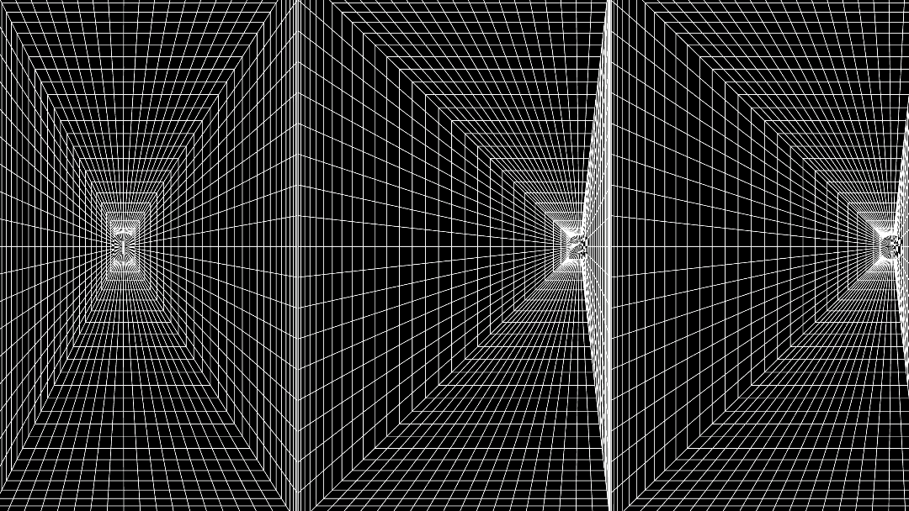

# Reactive Signs 2026

Interactive posters built with
[p5.js](https://p5js.org/) that react to visitors moving through the room. An
overhead camera tracks people and broadcasts their position; each poster reads
that position and responds. When the camera is not running, the **mouse** stands
in for a person, so you can build and test everything in the browser.



## Repository structure

- **`2026_Exhibition/`** — the exhibition app (this is what runs on location).
  One poster fills the screen and reacts to the tracked position. It also
  contains two helper views. See [`2026_Exhibition/README.md`](2026_Exhibition/README.md)
  for details.
  - `Poster/Template/` — **where students write their poster** (edit `sketch.js`).
  - `InfinityRoom/` — 3D preview of the mirrored exhibition room (no tracking).
  - `Tracking/` — top-down view that visualises the tracked position.
- **`cameraPoseOSC/`** — Python pose detection.
- **`library/`** — source of the poster-support library (`postercontrol`). The
  built file already ships in `2026_Exhibition/Poster/libraries/`, so you only
  need this to **modify the library itself** (`npm install`, then `npm run build`).

## Running the exhibition

In VS Code, use the **Live Server** extension: right-click
`2026_Exhibition/index.html` → **Open with Live Server**. It serves on
`http://localhost:5500/`, so the three views are:

- `http://localhost:5500/2026_Exhibition/` — the poster
- `http://localhost:5500/2026_Exhibition/InfinityRoom/` — the room preview
- `http://localhost:5500/2026_Exhibition/Tracking/` — the tracking view

## Writing a poster

Work inside `2026_Exhibition/Poster/Template/` — edit `sketch.js`. Without the camera, the poster follows the **mouse**. Read the
tracked position through these variables (do **not** use `mouseX` / `mouseY`
directly, or the poster will not work with tracking):

```javascript
poster.position.x / .y   // tracked position, in pixels
poster.posNormal.x / .y  // same, normalised 0..1
poster.vw / poster.vh    // 1% of viewport width / height (safer than pixels)
```

Because the camera looks **down** on the room:

- `x` = movement **left ↔ right** across the room.
- `y` = movement **toward ↔ away from the screen** (depth).

## Recording

The library can capture the canvas: press **Shift-R** to start recording and
**Shift-S** to stop and save to your downloads folder.
